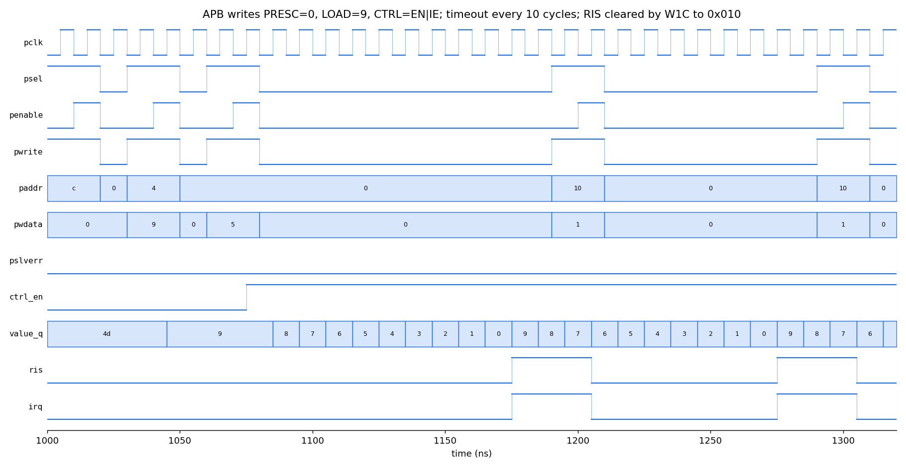

# APB Timer Peripheral: Design & Verification

[](https://github.com/Git-2001Abhishek/APB-Timer-Peripheral-Design-Verification-/actions/workflows/ci.yml)

A 32-bit programmable down-counting timer with a 16-bit prescaler,
periodic and one-shot modes, and a maskable interrupt, accessed through an
AMBA **APB3** slave interface. Written in SystemVerilog and verified two
ways:

- **Simulation**: self-checking testbench with a reference model,
  scoreboard, protocol checks, directed and constrained-random tests,
  functional coverage and mutation testing.
- **Formal**: an unbounded proof (k-induction, SymbiYosys) of the
  register, counter, interrupt and APB-response behaviour.

## Features

- AMBA APB3 slave: zero wait states, `PSLVERR` on illegal accesses
- 32-bit down counter with auto-reload (periodic) or one-shot mode
- 16-bit prescaler: the counter steps every `PRESC + 1` clock cycles
- Raw / masked interrupt status, write-1-to-clear, level `irq` output
- Read-only ID register for software discovery
- Fully synchronous design with an active-low asynchronous reset; synthesizes
  to 100 flip-flops and no latches

## Interface

| Signal | Dir | Width | Description |
| --- | --- | --- | --- |
| `pclk` | in | 1 | APB clock (also the timer clock) |
| `presetn` | in | 1 | Active-low asynchronous reset |
| `psel`, `penable`, `pwrite` | in | 1 | APB control |
| `paddr` | in | `ADDR_WIDTH` (12) | Byte address, `PADDR[1:0]` ignored |
| `pwdata` / `prdata` | in / out | 32 | Write / read data |
| `pready` | out | 1 | Always 1 (zero wait states) |
| `pslverr` | out | 1 | Error response |
| `irq` | out | 1 | Interrupt, `RIS & IE` |

## Register map

| Offset | Name | Access | Reset | Description |
| --- | --- | --- | --- | --- |
| 0x00 | `CTRL` | RW | 0 | `[0]` EN: count enable, `[1]` MODE: 0 = periodic, 1 = one-shot, `[2]` IE: interrupt enable |
| 0x04 | `LOAD` | RW | 0 | Reload value. Writing it also loads `VALUE` and restarts the prescaler |
| 0x08 | `VALUE` | RO | 0 | Current count |
| 0x0C | `PRESC` | RW | 0 | `[15:0]` prescaler divide value |
| 0x10 | `RIS` | RW1C | 0 | `[0]` raw interrupt status, set on timeout, write 1 to clear |
| 0x14 | `MIS` | RO | 0 | `[0]` masked interrupt status = `RIS & IE` |
| 0x18 | `ID` | RO | `0x41505431` | "APT1" |

Any other address, and any write to `VALUE`, `MIS` or `ID`, gets
`PSLVERR = 1` and leaves all state unchanged. Reserved bits read as 0.

## Operation

```text
           PRESC+1 cycles          PRESC+1 cycles
 prescaler |0 1 .. PRESC|0 1 .. PRESC| ...
 VALUE      LOAD  LOAD-1  ...  1   0   -> timeout: RIS=1
                                         periodic: VALUE <- LOAD
                                         one-shot: EN <- 0, VALUE stays 0
```

- While `EN = 1` the prescaler counts `0 .. PRESC`. Each wrap is one step of
  the counter. A step with `VALUE = 0` is a **timeout**.
- Periodic timeout period: **`(LOAD + 1) × (PRESC + 1)` clock cycles**.
- While `EN = 0`, `VALUE` holds its value and the prescaler is cleared.
- Lowering `PRESC` below the prescaler's current count while running makes
  it wrap on the next cycle; it does not run on to 2^16.
- After a one-shot timeout `VALUE` is 0. Setting `EN` again without
  rewriting `LOAD` therefore times out again after `PRESC + 1` cycles.
  Write `LOAD` first to start a new full-length countdown.
- Same-cycle priorities: a `LOAD` write beats counting (and suppresses that
  cycle's timeout), a timeout setting `RIS` beats a W1C clear, and a software
  `CTRL` write beats the one-shot auto-clear of `EN`.

Typical use:

```c
TIMER->PRESC = 99;              // 100 MHz / 100 = 1 MHz tick
TIMER->LOAD  = 999;             // 1000 ticks -> 1 ms period
TIMER->CTRL  = EN | IE;         // periodic, interrupt enabled
...
void timer_isr(void) { TIMER->RIS = 1; /* ... */ }
```

## Verification

[`tb/tb_apb_timer.sv`](tb/tb_apb_timer.sv)

```text
 directed + random tests ──► APB master BFM ──► apb_timer (DUT)
                                   │                  │
                                   ▼                  ▼
                           reference model ──► scoreboard (every cycle)
                                   │           protocol checker
                                   ▼
                           coverage counters
```

- **APB master BFM**: `apb_write` / `apb_read` tasks drive proper
  SETUP → ACCESS phases. Every read is compared against the model, and
  every `PSLVERR` against the expected error.
- **Reference model**: an independent cycle-accurate model of the register
  map and counter. The scoreboard compares `irq`, `VALUE`, the prescaler,
  `CTRL` and `RIS` with the DUT **on every clock cycle**.
- **Protocol checks**: `PENABLE` only after a SETUP phase, `PSLVERR` only
  in the ACCESS phase, `PREADY` high.

| # | Test | Checks (hand-computed, independent of the model) |
| --- | --- | --- |
| 1 | Reset values | all registers, `ID`, `irq` low |
| 2 | Register access | readback, reserved bits, 16-bit `PRESC`, `LOAD` also loads `VALUE`, `PADDR[1:0]` ignored |
| 3 | Error responses | unmapped reads/writes and writes to RO registers → `PSLVERR`, no state change |
| 4 | Periodic timing | measured `irq` period equals `(LOAD+1)(PRESC+1)` for 10, 20, 40 and 48 cycles |
| 5 | One-shot | fires once, `EN` clears, `VALUE` stays 0, no further interrupts, re-arm works |
| 6 | Interrupt masking | `RIS` vs `MIS` vs `irq` with `IE` = 0/1, writing 0 to `RIS` has no effect, W1C clears |
| 7 | Timeout vs W1C | with a timeout every cycle a W1C cannot clear `RIS` |
| 8 | Disable | `EN = 0` freezes `VALUE`, re-enabling resumes counting |
| 9 | Reset while running | everything returns to reset values |
| 10 | `PRESC` lowered mid-count | `PRESC` 1000 → 4 after 50 cycles: the timeout comes within 20 cycles, not after a 2^16 wrap |
| 11 | `CTRL` write vs one-shot stop | a `CTRL` write timed to land exactly on a one-shot timeout: the software write wins |
| 12 | Constrained random | 4000 APB transactions: random registers and data, small `LOAD` / `PRESC` so timeouts happen often, 8 % illegal / unaligned addresses, random idle gaps |

### Results

[`results/sim.log`](results/sim.log): **TEST PASSED**, 21,631 cycles,
zero scoreboard mismatches. Functional coverage, with no holes:

```text
periodic timeouts           : 416
one-shot timeouts           : 46
RIS W1C clears              : 171
timeout vs W1C collisions   : 4
LOAD write pre-empting tmo  : 4
CTRL write vs one-shot stop : 1
read errors / write errors  : 115 / 893
reads  CTRL LOAD VALUE PRESC RIS MIS ID : 280 269 255 265 276 289 274
writes CTRL LOAD VALUE PRESC RIS MIS ID : 345 270 269 286 318 261 244
coverage holes              : 0
```

**Mutation testing** ([`scripts/mutate.py`](scripts/mutate.py),
[`results/mutation.log`](results/mutation.log)). To show the testbench
actually finds bugs, ten realistic bugs are injected into the RTL one at a
time. **All 12 are detected**:

| Injected bug | Errors reported |
| --- | --- |
| W1C clear beats timeout | 83 |
| Periodic reload off by one | 6215 |
| No `PSLVERR` on read-only write | 777 |
| Prescaler not cleared when disabled | 2196 |
| One-shot never stops | 12159 |
| `irq` ignores `IE` | 5061 |
| `LOAD` write does not restart prescaler | 4189 |
| `PRESC` register only 8 bits | 2 |
| `PADDR[1:0]` not ignored | 4761 |
| Prescaler compare `==` instead of `>=` | 4718 |
| One-shot stop beats `CTRL` write | 5 |
| `MIS` reads raw status | 67 |

Waveform: programming the timer over APB (`LOAD = 9`, `CTRL = EN|IE`),
`VALUE` counting 9 → 0, a timeout every 10 cycles, and the interrupt
cleared by a W1C write to `RIS` (0x010):



Synthesis (Yosys, generic gates) - [`results/synth_stat.txt`](results/synth_stat.txt):
734 cells and 100 flip-flops (3 `CTRL` + 32 `LOAD` + 32 `VALUE` + 16 `PRESC`
+ 16 prescaler count + 1 `RIS`), no latches.

## Formal verification

The properties are in [`rtl/apb_timer.sv`](rtl/apb_timer.sv) under
`ifdef FORMAL`, run by [`formal/apb_timer.sby`](formal/apb_timer.sby).

**Assumptions**: a legal APB3 master. `PENABLE` only follows a SETUP
cycle, address, control and data stay stable into ACCESS, and a transfer
ends after one ACCESS cycle. Every trace starts in reset.

**Assertions** (checked in every reachable state, any number of cycles
deep):

| Group | Property |
| --- | --- |
| APB response | `PREADY` always 1. `PSLVERR` only in ACCESS, and equal to an independent decode of the register map. `PRDATA` is 0 outside read accesses |
| Interrupt | `irq == RIS & IE`. `RIS` rises only on a timeout and falls only on a W1C write. A timeout always wins over a simultaneous W1C |
| Register safety | a rejected (`PSLVERR`) write changes no register |
| Counter | a `LOAD` write loads `VALUE` and restarts the prescaler. Disabled → `VALUE` holds and the prescaler is 0. Each step decrements `VALUE` by exactly 1, and `VALUE` holds between steps |
| Timeout | periodic reloads `LOAD`. One-shot clears `EN` and leaves `VALUE` at 0 (unless software rewrote `CTRL` in that cycle) |
| Prescaler | never exceeds `PRESC`, except the single cycle after `PRESC` is lowered |

Results ([`results/formal_mutation.log`](results/formal_mutation.log)):

- `prove` task: **successful proof by k-induction** (depth 8, about 5 s).
- `cover` task: periodic timeout, one-shot timeout, `PSLVERR`, `irq`, and a
  timeout colliding with a W1C are all reachable. This shows the
  assumptions don't rule out the interesting behaviour, so the proof isn't
  vacuous.
- **Formal mutation testing**: seven bugs injected one at a time. **All 7
  break the proof**: six give a concrete counterexample, and the `==`
  prescaler bug makes the property unprovable.

  | Injected bug | Proof result |
  | --- | --- |
  | W1C clear beats timeout | FAIL (counterexample) |
  | Periodic reload off by one | FAIL |
  | No `PSLVERR` on read-only write | FAIL |
  | One-shot never stops | FAIL |
  | `irq` ignores `IE` | FAIL |
  | Prescaler compare `==` instead of `>=` | UNKNOWN (no longer provable) |
  | `PRDATA` driven outside read access | FAIL |

  The first version of the properties let two of these mutants through.
  The W1C/timeout priority and the `PSLVERR` decode were only partly
  specified; both properties were tightened.

## How to run

Requires Icarus Verilog 12+ and Python 3. Yosys, Verilator and
SymbiYosys (with z3) are needed for synthesis, lint and formal; the
[OSS CAD Suite](https://github.com/YosysHQ/oss-cad-suite-build) has all
of them. Everything runs in GitHub Actions on every push
([`.github/workflows/ci.yml`](.github/workflows/ci.yml)).

```bash
make sim        # testbench -> results/sim.log, results/apb_timer.vcd
make mutate     # mutation testing -> results/mutation.log
make synth      # Yosys synthesis check
make lint       # Verilator -Wall lint (clean)
make formal     # SymbiYosys: unbounded proof + cover
make formal-mutate   # check injected bugs break the proof
make wave       # GTKWave
```

Without `make`:

```bash
iverilog -g2012 -o sim.vvp -s tb_apb_timer rtl/apb_timer.sv tb/tb_apb_timer.sv
vvp -n sim.vvp
```

## Tools

- SystemVerilog
- Icarus Verilog
- Verilator (lint)
- Yosys
- SymbiYosys + z3 (formal)
- GitHub Actions (CI)
- GTKWave / Python + matplotlib (waveform figure)

## Repository Structure

```text
rtl/        - apb_timer.sv (formal properties under `ifdef FORMAL`)
tb/         - Testbench (BFM, reference model, scoreboard, coverage)
formal/     - SymbiYosys job
scripts/    - Mutation testing (simulation and formal), waveform plotting
results/    - Simulation, mutation and formal-mutation logs, synthesis stats, waveform
.github/    - CI workflow
```
